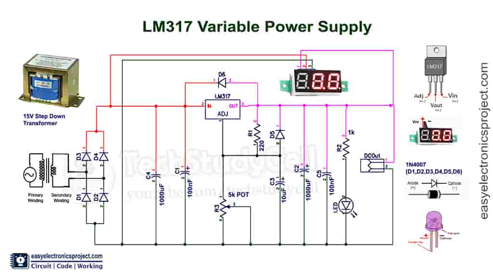

# Arduino-PIC Programmer — Professional Desktop EXE

**Direct Download (Windows x64 EXE):**
[Click here to download Arduino-PIC-Programmer.exe](https://github.com/Ahmed-Emad-EL-Din/Arduino-PIC-Programmer/releases/download/v2.0.0/Arduino-PIC-Programmer-Windows-x64.zip) *(Extract the ZIP and run the EXE)*

**Made By:** Ahmed Emad El-Din Hussein · [https://github.com/Ahmed-Emad-EL-Din](https://github.com/Ahmed-Emad-EL-Din)

---

## 1. Hardware Connection & 13V Supply Circuit (LM317 + 24V DC)

### Required Components
*   **Arduino Board:** Uno / Nano / Pro Mini / Mega / Leonardo / Micro
*   **Target PIC MCU:** PIC16F84A (default) or 24 other supported MCUs (PIC12F675, PIC16F877A, etc.)
*   **24V DC Power Supply** (Input)
*   **LM317 Voltage Regulator Circuit** (Output: 13V VPP + 5V VDD)
*   **ZIF-18 Socket** (or ICSP Header for 14/20/28/40-pin MCUs)
*   **Wiring:** D2→VDD, D3→MCLR/VPP, D4→CLK, D5→DATA, /RESET→2.2µF Cap→GND

### 13V VPP Supply Diagram (LM317 + 24V DC)

*Values: R1 = 120Ω, R2 = 2.2kΩ (Output ≈ 13V VPP), Input = 24V DC, Output Capacitor = 100nF, Pull-up = 10kΩ, PGM Pull-down = 4.7kΩ.*

### Accurate Circuit Diagrams (Dynamic per MCU)
**A. ZIF-18 Direct Mode (8-pin & 18-pin PICs)**

*   **PIC16F84A (18-pin):** JP3 = `1-2`. Pins: VDD=14, VSS=5, MCLR=4(RA5), PGC=12(RB6), PGD=13(RB7), PGM=10(RB4).
*   **PIC12F675 (8-pin):** JP3 = `2-3`. Pins: VDD=1, VSS=8, MCLR=4(GP3), PGC=6(GP1), PGD=7(GP0).
*   **Visual:** [Image: docs/screenshots/workbench_light_zif8_675.png] (ZIF-18 JP3=2-3)

**B. ICSP Cable / Adapter Mode (14/20/28/40-pin PICs)**

*   **PIC16F877A (40-pin):** ICSP Header. Pins: VDD=11&32, VSS=12&31, MCLR=1, PGC=39(RB6), PGD=40(RB7), PGM=36(RB3).

**C. HEX Memory Map Inspector**

(Visual usage bars + flat word dump)

---

## 2. Step-by-Step Usage

### Step 1 — Flash Arduino Firmware (Once)
1. Launch **Arduino-PIC-Programmer.exe**.
2. Menu **Programmer → Flash Arduino Firmware…**
3. Pick board (e.g., *Arduino Uno*) and COM port.
4. Press **Flash Firmware** (uses bundled `avrdude`).
5. Confirm success (ProgramPic v1.8.horo uploaded).

### Step 2 — Connect & Verify
1. Connect Arduino to PC. Connect 24V DC to LM317 circuit.
2. Select Board and COM Port in the app.
3. Press **Connect Programmer** (`Ctrl+P`).
4. Status chip turns **Green (Programmer: ✓ vX)** — Handshake passed.

### Step 3 — Load HEX & Select MCU
1. **Open HEX…** (`Ctrl+O`) or drag-and-drop `.hex` file.
2. Pick Target MCU (e.g., **PIC16F84A**) from dropdown.
3. **Detect Chip** (`F6`) — verifies Device ID matches selection.

### Step 4 — Preflight & Programming
1. **Preflight Checklist** appears (VPP LED, Socket, Jumper, Voltage). Tick all items.
2. **Confirmation Dialog** shows exact operation (Erase → Write → Verify → Safe State).
3. Press **Program & Verify** (`Ctrl+R`).
4. **Activity Log** tracks progress:
   ```
   Step 1/5 — verify chip identity … Detected: PIC16F84A … identity OK
   Step 2/5 — erase chip …
   Step 3/5 — write program memory …
   Step 4/5 — READ BACK & VERIFY … ✓ verify passed
   Step 5/5 — power off socket (safe state) …
   ```
5. **SUCCESS** dialog appears.

### Step 5 — Other Operations
*   **Erase Only…** — bulk erase with calibration preservation.
*   **Verify vs File** — read chip and compare against loaded HEX.
*   **Read Chip → Save HEX…** (`Ctrl+S`) — backup chip to Intel HEX.
*   **Device Info** — port, firmware version, device ID, config word.

---

## 3. Safety Design (Zero Hardware Damage)
| Gate | Behaviour |
|---|---|
| Programmer verified | Handshake required before any command |
| Device-ID match | Chip ID must equal selected MCU (mask `0xFFE0`) |
| Empty socket / no VPP | ID `0x3FFF` or unreadable chip → refused |
| No-ID chips (PIC16F84) | Explicit warnings + forced `SETDEVICE` map |
| HEX fit check | HEX must only touch existing regions |
| Preflight checklist | VPP LED, socket, jumper, voltage — all items ticked |
| Confirmations | Erase/program dialogs spell out exact actions |
| Verify after write | ON by default; extra confirmation to disable |
| Safe state | `PWROFF` after every operation, errors, cancel, close |
| Firmware safety net | ProgramPic auto power-offs after 2s inactivity |

---

## 4. Supported Targets (25 MCUs)
`PIC16F84A` (default), PIC16F84, PIC16F627/A, PIC16F628/A, PIC16F648A,
PIC16F630, PIC16F676, PIC16F684, PIC16F688, PIC16F690, PIC16F87, PIC16F88,
PIC16F872, PIC16F877/A, PIC16F882–887, PIC12F629, PIC12F675, PIC12F683.

---

## 5. Requirements
* **Windows 10/11** (EXE build)
* **Arduino Board** + **LM317 13V Circuit** + **ZIF/ICSP Shield**
* **24V DC Supply** (Input for LM317)
* **Bundled avrdude** (included in EXE)

---

## 6. Project Layout (Internal)
```
├── plain.md                  # task plan (all [x])
├── src/                      # core engine + GUI (PySide6)
├── firmware/                 # ProgramPic v1.8.horo sketch
├── tools/                    # avrdude (bundled)
├── assets/                   # reference schematics & icons
├── packaging/                # PyInstaller spec
└── docs/                     # user guide + screenshots
```

---

## 7. Credits & License
* **Author:** Ahmed Emad El-Din Hussein · [https://github.com/Ahmed-Emad-EL-Din](https://github.com/Ahmed-Emad-EL-Din)
* **Firmware:** ProgramPic v1.8.horo (Ho-Ro/ArdPicProg) — GPL-3.0
* **Design:** Unslop Desktop Workbench (4px grid, >=4.5:1 contrast)
* **License:** GPL-3.0 — see [LICENSE](LICENSE)

---

## 8. Disclaimer
High-voltage (≈13 V) programming circuitry is involved. The author assumes
no responsibility for damaged chips, boards, or injury. Always verify
wiring, VPP supply, and device selection before programming.
